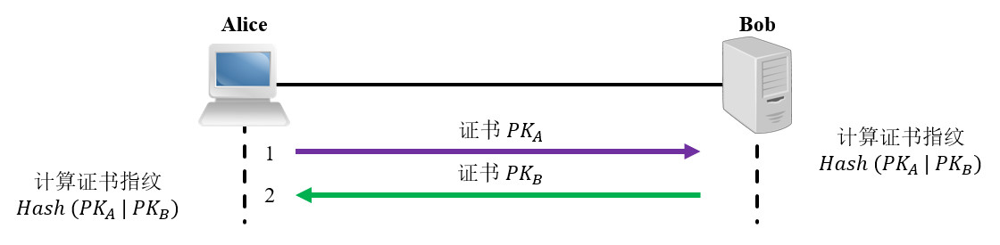
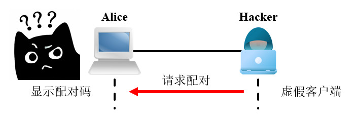
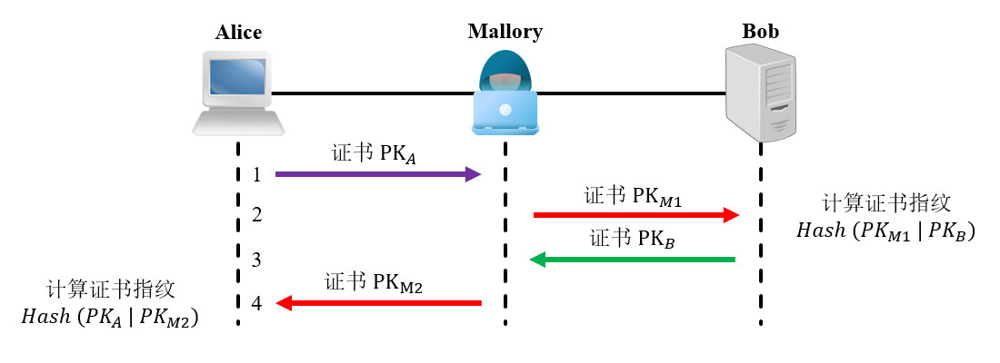
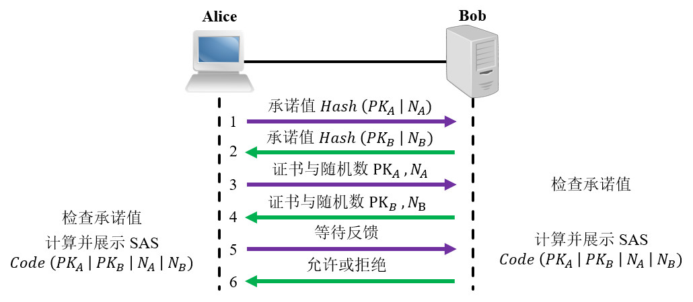

# 简介
SSL -> TLS

验证服务端身份，交换临时密钥，并进行加密通信。


SSL/TLS是一种密码通信框架，他是世界上使用最广泛的密码通信方法。SSL/TLS综合运用了密码学中的对称密码，消息认证码，公钥密码，数字签名，伪随机数生成器等，可以说是密码学中的集大成者。

SSL(Secure Socket Layer)安全套接层，是1994年由Netscape公司设计的一套协议，并与1995年发布了3.0版本。

TLS(Transport Layer Security)传输层安全是IETF在SSL3.0基础上设计的协议，实际上相当于SSL的后续版本。

SSL 协议现已被 TLS 协议取代，通常语境下SSL是指标识通信双方身份的数字证书。

TLS位于传输层与应用层之间，上面可以承载HTTP协议或者SMTP/POP3/FTP协议等。


    TLS 1.0：
        基于 SSL 3.0，安全性较低，已不推荐使用。
    TLS 1.1：
        修复了 TLS 1.0 的部分漏洞，但仍存在安全隐患。
    TLS 1.2：
        目前广泛使用的版本，提供了更强的安全性。
    TLS 1.3：
        最新的版本，简化了握手过程，提供了更强的安全性和性能。


# 工作流程

客户端   服务端

->  Client Hello

支持的加密算法列表

-< Server Hello

选择的算法，证书

验证证书

生成预主密钥

-> 使用服务器公钥加密预主密钥

生成会话密钥

通道建立，可双向加密通信。


高效加密传输：

使用非对称加密（如 RSA、ECDHE）交换密钥。
使用对称加密（如 AES）加密后续数据。


身份验证：

    通过服务器证书验证服务器的身份。
    可选地通过客户端证书验证客户端的身份。

数据完整性：

    使用哈希算法（如 SHA）确保数据未被篡改。

前向保密：

    使用临时密钥交换算法（如 ECDHE），即使长期密钥泄露，历史通信也不会被解密。


# mTLS


mTLS 双向加密，普通tls适用于大多数浏览器应用，验证服务端身份，避免客户端访问虚假网站，

双向加密适用于定制化系统和P2P应用，需要验证双方身份，防止客户端伪造身份。


# P2P 通信安全
## 简介
P2P 节点可能经常移动，它们的 IP 地址等

P2P 软件可能被安装在任意客户端上，无法通过CA提前签发证书

没有CA带来的问题是信任锚点缺失，我们必须寻找一个信任锚点，确保双方识别对方身份。


内置私有根证书（Private CA / Root CA Pinning）   原理：开发者在自己的应用生态内部构建一个私有的根证书颁发机构（Root CA）。用这个私有根 CA 动态签发各个 P2P 节点的叶子证书。   实现方式：将该私有根证书的公钥直接硬编码（Hardcode）或打包在你的 P2P 客户端软件中。优点：应用内的所有节点互相通信时，只要是由这个私有根签发的证书，客户端都会无条件信任。无需每次都做 TOFU 确认。   缺点：如果私有根证书的私钥泄露，整个 P2P 网络将面临全局安全风险。

适合内部系统互联，不适合公开服务


TOFU（Trust On First Use，首次使用信任原则）—— 最契合P2P原理：类似于 SSH 连接第一次连接远程服务器时的机制。客户端在第一次与节点建立连接时，获取并本地缓存该节点的自签证书公钥或指纹（Fingerprint）。在后续的连接中，只要对方出示的证书指纹与第一次保存的一致，就信任该连接。优点：完美适配没有域名、IP 经常变动、无法使用公共 CA 的 P2P 场景。缺点：如果初次连接时遭受中间人攻击（主动攻击），恶意公钥会被错误信任。因此，初次交换指纹时，通常需要结合带外验证（例如：通过安全的二维码扫描、已登录的中心化信令服务器转发、或者文本口令比对）。

操作流程繁琐，只适合系统内部管理，不太适合面向大众的应用


配对机制


利用去中心化身份（DID）或公钥指纹作为标识原理：在一些现代 P2P 网络（如 WebRTC 的底层、IPFS、Matrix）中，节点的“身份”本身就是其公钥的哈希（PeerID）。实现方式：通信时双方直接交换各自的公钥，并用该公钥对会话进行签名验证（自证明身份，Self-Certifying ID）。TLS 层的证书可以直接动态生成，只要验证“证书中的公钥哈希 == 对方的 PeerID”，就可以直接建立加密且可信的连接。


该方案是 TOFU 的延伸，TOFU 需要用户主动配置两个设备的身份关联，配对机制则由一端申请配对，另一端询问用户是否确认，然后自动记录信任关系，简化了配对流程，适合面向大众的应用，例如蓝牙、屏幕投射等都采用了该方案。


## 配对机制
方案四比较复杂且常用，下文将对其进行详细介绍。


### 证书摘要对比
两个节点首次通信时，我们可以交换并核对双方的证书或公钥，验证链路对端节点身份，避免虚假客户端与中间人攻击。

下文图片展示了正常情况下的节点配对流程：

<div align=center>



</div>

Alice 与 Bob 互相交换 SSL 证书（包含公钥 $PK$ ），双方使用相同的散列算法（例如：SHA 256），分别计算自身公钥与对端公钥的消息摘要。

数字证书是一种不等长、结构化的文件，逐项核对比较麻烦，因此我们将证书的二进制数据转换为消息摘要，便于人类视觉或程序核验。数字证书的消息摘要也被称为“证书指纹 (Certificate Fingerprint)”，散列算法的特点是输入轻微变化时输出发生剧烈变化，在此类场景中非常适合用于鉴别对端身份是否变更。

P2P 场景中没有中心化的 CA 负责签发证书，对端可以随意声明组织名称等信息，我们可以只使用证书中的公钥作为节点身份标识，忽略证书信息、签名等部分。

```text
Alice 查看 Bob 所发送证书的指纹：
8A09F5036655EF37559B9A960A19E0C8B046AD2F910AA742C3E0028664238026

Alice 计算自身证书与 Bob 所发送证书的消息摘要：
8A09F5036655EF37559B9A960A19E0C8B046AD2F910AA742C3E0028664238026

$PK$

Bob 查看 Alice 所发送证书的指纹：
8A09F5036655EF37559B9A960A19E0C8B046AD2F910AA742C3E0028664238026

Bob 计算自身证书与 Alice 所发送证书的消息摘要：
8A09F5036655EF37559B9A960A19E0C8B046AD2F910AA742C3E0028664238026
```

证书交换完成后，

两端通过检查对端证书的指纹，能够确认对端身份，防止虚假客户端。
此时两端设备计算出的消息摘要一致，说明通信链路未经中间人篡改，防止中间人攻击。

如果两端设备由同一人员管理，操作者可以直接观察并对比两个设备的消息摘要是否一致，判断通信链路是否安全。

如果两端设备由不同人员管理，操作双方可以通过电话、邮件等安全链路交换证书指纹与消息摘要并进行对比。

操作人员核对消息摘要并选择是否信任的行为，即为信任锚点；若操作人员批准配对，两端设备应当将对端证书指纹写入文件或数据库，后续通信时只要远端证书与本地证书的消息摘要在已知记录中，


此时操作人员的摘要核对动作即为信任锚点，双方随后将摘要记录至设备中，后续通信时只要远端证书与本地证书的消息摘要与设备记录匹配，即可确认对端身份 通信是安全的。

假设攻击者试图伪装成已认证的对端发出控制指令，本端获取其证书并计算出消息摘要，随后在设备记录中查找，但没有找到任何记录，则认为


下文图片展示了虚假客户端攻击的情形：

<div align=center>



</div>

虚假客户端的目的是欺骗用户设备，使其将身份信息录入信任列表，后续便能发起控制指令操作用户设备。

用户发起配对时，已经有预期两个设备会弹出配对询问窗口，如果未发起配对时伪造客户端发起请求，用户就会发现并识别出本次配对不是预期的，从而终止配对。

下文图片展示了中间人攻击的情形：

<div align=center>



</div>

中间人的目的是在配对阶段使得两端

中间人如果给A发B的公钥，给B发A的公钥，可以使得两端显示一致，但由于没有双方的私钥，此时无法解密消息。
为了截获数据，中间人发送自己的公钥摘要

二者大概率不一致，A与B核对时能够发现问题

采用证书计算完整摘要时，攻击者很难找到使得两侧显示摘要相等的证书，因此可以认为几乎无法破解。


### 短码对比
证书消息摘要通常使用 SHA-256 或更高级别的散列算法，值域空间至少为 $2^256$ ，攻击者难以寻找中间证书使得两侧显示的指纹相同，因此我们认为这种方式是安全的。

简短认证字符串 (Short Authentication String, SAS) 是 4 至 8 位的数字代码，由
在客户端显示完整的摘要结果，通常采用256位的SHA算法，值域空间为 2^256，攻击者难以猜测结果并伪造身份，但用户可能会觉得麻烦从而直接点击确认，安全机制失效，因此可以将摘要取部分数据，显示为4-8位的短码，便于用户对比。

采用证书计算短码时，值域空间为 10 ^ 6，攻击者可以使用很多证书进行匹配，寻找使得两端数字相同的第三个证书，从而监听所有数据，因此通常还需要引入以下机制。


🔷 Nonce

如果我们基于证书生成短码，一对设备的短码总是相同，用户可能会记住短码并在配对界面出现时习惯性地按下确认按钮。

攻击者虽然无法解密不知道这个加密密文（Ciphertext）里写的究竟是什么（因为他没有密钥解密），但他通过观察流量特征，知道这个密文在特定场景下代表“执行某个关键动作”。

如果没有随机数，某一次合法配对的所有交互数据（公钥、计算出的配对码、确认信号）如果被恶意攻击者录制下来。

在未来的某个时间，如果设备因为某种原因重置了信任关系，或者攻击者试图欺骗用户重新走一次配对流程，攻击者就可以用这些旧的录像去“重放”整个欺骗过程，诱导用户在毫无防备的情况下再次按下“确认信任”。

用户可能会记住配对码并习惯性点击确认，导致安全机制失效。

Nonce (Number used once) 是一对随机数，在每次配对过程中，双方各自生成一个随机数并进行交换，然后将证书与随机数都作为短码生成数据；这种设计可以确保相同设备每次配对时短码不同，引起用户注意，避免重放攻击。


🔷 Commitment Scheme

在摘要对比方案中，中间人要使两端显示的证书摘要一致，值域空间为 $ 2^256 $ ，几乎不可能实现，因此概率上认为是安全的。

当我们使用配对码时，
6位数值域空间较小， 中间人可以截获一方的消息，并寻找一个使得双方显示sas相同的证书，然后进行配对，用来解密并透明转发数据。


随机数作为配对码生成依据后，仍可能被穷举，使攻击者构造出在两端相同的数据包。使得双向显示号码相同的伪消息。

双方先交换随机数和公钥的hash
再交换公钥和随机数

客户端发送数据前，hash已提前发送到服务端 ，攻击者难以反推原随机数并构造出符合hash的假数据，进行篡改。提高中间人攻击的难度。

<div align=center>



</div>


1. A → B：Commit
A 生成随机数  Na ，发送承诺  Ca = H(Na ‖ PKa ‖ 上下文) （只发哈希，不发  Na ）。
同时可携带 A 的公钥/DH 公值  PKa （或包含在哈希内）。
1. B → A：B 的公钥 + 随机数  Nb （明文）
B 此时已见到  Ca ，但无法反推  Na ；B 发送  PKb  与  Nb 。
1. A → B：Reveal
A 收到  Nb  后，才发送  Na （及  PKa ）。
1. B 校验：重新计算  H(Na ‖ PKa ‖ 上下文) ，必须等于  Ca ，否则中止。
2. 双方各自计算 SAS
SAS = Truncate( H(PKa ‖ PKb ‖ Na ‖ Nb ‖ 会话上下文) ) （如 6 位数字/几个 emoji）。


