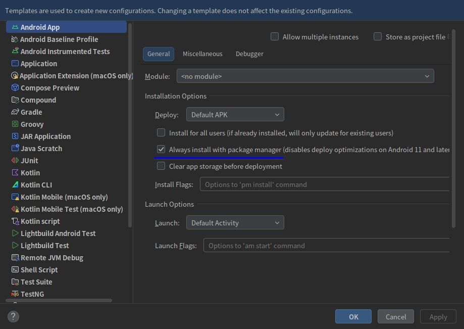

# 简介
AVD(Android Virtual Device) 是 Android SDK 提供的 Android 模拟器，基于 QEMU 实现，能够模拟不同屏幕尺寸、分辨率、系统版本、硬件架构的 Android 设备，以便开发者对应用程序进行调试。


# 虚拟网络
默认情况下，AVD 的虚拟网络工作在 NAT 模式，虚拟机可以访问互联网与主机网络。

主机在虚拟网络中的 IP 是 `10.0.2.2` 和 `10.0.2.3`，如果主机在 `8080` 端口上开放了 HTTP 服务，虚拟机便可通过 `http://10.0.2.2:8080` 访问该服务。


# 查看错误日志
有时 AVD 会启动失败并显示弹窗： `The emulator process for AVD <虚拟机名称> has terminated.`，这是由于系统环境或配置出现问题导致的，但此处没有更多详细信息供我们排查具体原因。

我们可以在 Android Studio 的用户数据目录中找到日志文件，并查找与 AVD 有关的错误信息：

- Windows平台 : `%USERPROFILE%\AppData\Local\Google\<Android Studio版本号>\log\`
- Linux平台 : `~/.cache/Google/<Android Studio版本号>/log/`

下文代码块展示了一个 AVD 启动失败的错误信息示例：

```text
09:49:27,745 [ 976238] INFO - Emulator: Pixel - Android emulator version 34.2.15.0 (build_id 11906825) (CL:N/A)
09:49:27,745 [ 976238] INFO - Emulator: Pixel - Found systemPath /home/bi4vmr/Software/Android-SDK/system-images/android-33/default/x86_64/
09:49:27,751 [ 976244] INFO - Emulator: Pixel - /home/bi4vmr/Software/Android-SDK/emulator/qemu/linux-x86_64/qemu-system-x86_64: /lib/x86_64-linux-gnu/libpthread.so.0: version GLIBC_2.30' not found (required by /home/bi4vmr/Software/Android-SDK/emulator/lib64/qt/lib/libQt6WebEngineCoreAndroidEmu.so.6)
```

根据上述输出内容可知：

当前系统的 `libc` 库版本低于 AVD 所要求的版本，因此虚拟机无法启动成功，此时需要升级系统或将 AVD 降级至旧版本。


# 安装特定版本
当系统环境等因素有限制时，我们只能运行特定版本的 AVD，但 SDK 管理器中默认只显示最新版本的 AVD，无法直接降级至早期版本，此时可以手动进行降级。

安装指定版本 AVD 的操作步骤如下文内容所示：

第一步，访问 [🧭 AVD 历史版本存档](https://developer.android.com/studio/emulator_archive) 网页，选择目标版本 AVD 并下载压缩包，例如 `33.1.24` 。

第二步，进入 Android SDK 目录，将当前已经存在的 AVD 目录修改为其他名称，例如：将 `<SDK根目录>/emulator/` 改为 `<SDK根目录>/emulator_bak/` 。最好不要删除当前版本的 AVD 文件，它们在后续步骤中还有作用。

第三步，将压缩包中的 `emulator` 目录解压缩到 SDK 目录中。

第四步，进入“第二步”中已被重命名的原始 AVD 目录，将 `package.xml` 文件复制到“第三步”解压缩后的 `emulator` 目录中，然后修改该文件，将其中的版本号改为与当前 AVD 版本号一致：

"package.xml":

```xml
<ns2:repository ...>
    <localPackage ...>
        <revision>
            <major>33</major>
            <minor>1</minor>
            <micro>24</micro>
        </revision>
    </localPackage>
</ns2:repository>
```

此时目标版本的 AVD 就安装完成了，我们可以尝试创建并启动虚拟机。

> 🚩 提示
>
> 上文提到的“AVD 历史版本存档”网页中，只存在 Windows 平台的 AVD 程序包；若我们正在使用的是 Linux 平台，可以先访问网页查看目标 AVD 版本的 Windows 程序包下载地址，再将版本号部分拼接至 SDK 下载地址，下载对应的 Linux 程序包：
>
> 若我们希望安装 AVD 33.1.24，存档网页显示的 Windows 程序包下载地址为：
>
> `https://redirector.gvt1.com/edgedl/android/repository/emulator-windows_x64-11237101.zip`
>
> 此处的 `11237101` 即为版本号，我们将其填入以下 URL 即可下载对应的 Linux 程序包：
>
> `https://dl.google.com/android/repository/emulator-linux_x64-11237101.zip`


# 疑难解答
## 索引

<div align="center">

|       序号        |                            摘要                            |
| :---------------: | :--------------------------------------------------------: |
| [案例一](#案例一) | 使用 IDE 的 Run 更新安装 AVD 中的 APK 后，代码变更未生效。 |

</div>

## 案例一
### 问题描述
使用 IDE 的 Run 按钮更新安装 AVD 中已有的 APK 后，代码变更未生效，目标程序的行为与先前版本一致。

### 问题分析
该问题仅在 AVD 中出现，物理机和其他模拟器无法复现，具体原因不明。

### 解决方案
首先删除现有的运行配置，然后打开应用运行配置页面，点击左侧底部的 `Edit configuration templates` 文本，在模板编辑页面中勾选“禁用安装优化”。

<div align="center">



</div>

随后执行一次 Gradle Sync，重新生成的应用运行配置将默认禁用安装优化，代码修改能够正确反馈到最新 APK 中。

上述方法仅针对工程中具有大量 APP 模块的情况，逐个修改配置项比较麻烦，清空现有配置重建更为快捷。对于仅有少量 APP 模块的项目，逐个修改现有配置也是可以的。
